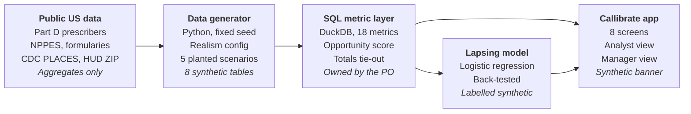

# Callibrate — Functional Requirements Document

Last updated 7 Nov 2026 (revised after independent review) · Product owner: Apoorva Bhardwaj

## Summary

This FRD turns the 14 version 1 business requirements in the [Callibrate BRD](BRD.md) into testable functional requirements across eight screens, one SQL metric layer and one synthetic data generator. It specifies what the app does and how every number is calculated, not how the code is written.

| Item | Detail |
| --- | --- |
| Product owner | Apoorva Bhardwaj |
| Status | Draft 0.1 |
| Traces to | BR-01 to BR-14 in the BRD |
| Build | Python web app (Streamlit-style); SQL (DuckDB) for every metric; Python only for data generation, charts and the lapsing model |
| Data | Synthetic only: 10,000 doctors, 40 reps, 104 weeks, eight data sets |

**ID conventions.** FR-xx = functional requirement; M-xx = metric definition; AT-xx = acceptance test. Feature codes (A1, B2, C1 and so on) match the BRD scope table.

## System overview

Callibrate has four layers: public data shapes a synthetic data generator, a SQL layer computes every metric, and the app displays them. Beyond the app itself, Python is used only for the data generator and the lapsing model.



Public files contribute distributions only; no real identifier passes beyond the first box. Every number on screen can be traced to one SQL file.

## Screens and navigation

Callibrate has eight screens in a left-hand menu, ordered the way an analyst works: see the brand, find where effort is misplaced, check execution, decide who to see, then diagnose. Every screen except Data and definitions opens with the same filter bar (FR-01).

| # | Screen | Answers the question | Main user | Features | BRs |
| --- | --- | --- | --- | --- | --- |
| S1 | Overview | How is the brand doing, and where should I look first? | All | A4, B4 (headline) | BR-04, BR-09 |
| S2 | Targeting | Are calls going to the doctors with the most potential? | Analyst, consultant | A1, B1 | BR-01, BR-06 |
| S3 | Coverage | Are target doctors seen, and seen often enough, everywhere? | Analyst, consultant | A2, A5, B2 | BR-02, BR-05, BR-07 |
| S4 | Field execution | Which reps are behind plan, and which important doctors did they miss? | Manager | A3, B2 | BR-03, BR-07 |
| S5 | Priority list | Who should each rep see next week, and why? | All | C1 | BR-10 |
| S6 | Lapsing watchlist | Which doctors are drifting away from the brand? | Analyst | C3 | BR-11 |
| S7 | Diagnose | Why did performance change in a region? | Analyst, consultant | B3, B4, A4 | BR-08, BR-09 |
| S8 | Data and definitions | How is every number calculated, and what can this data not prove? | All | D1, D2, D3 | BR-12, BR-13, BR-14 |

**Role views.** A role switch at the top (Analyst or District manager) changes defaults, not data. The manager view opens on S4, fixes the district filter to one district, and hides individual prescribing for PDRP opt-out doctors (FR-04).

## Global functional rules

Six rules apply on every screen, so a number means the same thing wherever it appears.

| ID | Rule | Detail |
| --- | --- | --- |
| FR-01 | Shared filter bar | Filters: period, region, district, territory, segment (A/B/C, non-target), specialty group, access tier. Filters persist when moving between screens. Every chart and table respects them. |
| FR-02 | Time periods | Weeks run Saturday to Friday. Selectable periods: latest week, latest 13 weeks (one quarter, the default), latest 26 weeks, latest 52 weeks, and any full quarter. Trends compare with the previous equal-length period. |
| FR-03 | Synthetic-data banner | A fixed banner on every screen: "All data is synthetic. No real doctor, rep, company or brand is shown." It cannot be dismissed. |
| FR-04 | PDRP masking | In the manager view, prescription figures for doctors with the PDRP opt-out flag show as "Restricted" at doctor level, in tables, tooltips, drill-downs and CSV exports alike. They still count in territory and higher totals, but any group of fewer than 5 doctors that includes an opted-out doctor shows "Restricted" so the doctor's figures cannot be inferred. This is a simplified demonstration; real restrictions depend on the data licence and company policy. |
| FR-05 | Metric tooltips and export | Every metric label shows its M-xx definition on hover and links to S8. Every table can be downloaded as CSV with the active filters written in its first row. |
| FR-06 | Associations, not causes | Every finding is worded as an observed association in synthetic data ("NBRx fell where rejections rose"), never as a proven cause. Charts that compare activity with outcomes carry this note. |

## Functional requirements by screen

Each screen has 3–5 requirements; metric codes (M-xx) point to the formulas in the next section.

### S1 Overview

| ID | Requirement |
| --- | --- |
| FR-10 | Show six KPI tiles for the selected period, each with the change against the previous equal period: TRx (M-01), NBRx (M-03), TRx market share (M-04), reach to decile 8–10 doctors (M-07), call-plan adherence (M-09), share of calls on low-potential doctors (M-12). |
| FR-11 | Show a 104-week trend of weekly TRx and NBRx for Glyvexa and its three competitors. |
| FR-12 | Show a "Where to look" panel of up to five alerts, each linking to the screen that explains it: territories below the reach threshold; territories with high effort but falling NBRx (FR-70); the number of doctors on the lapsing watchlist; reps below 80% adherence. |

### S2 Targeting

| ID | Requirement |
| --- | --- |
| FR-20 | Show, per decile, the number of doctors, their share of market TRx and their share of brand calls, so the gap between value and effort is visible. |
| FR-21 | Show a potential-by-penetration matrix: market decile bands (1–4, 5–7, 8–10) against brand share bands (low, medium, high). Each cell shows doctor count and share of calls; clicking a cell lists its doctors. |
| FR-22 | Show the misallocation quadrant: under-called high-potential doctors (decile 8–10 with fewer calls than planned, including none) and over-called low-potential doctors (decile 1–4 called more than their segment plan, or called while not targeted). Each list shows count, share of calls and the doctors. |
| FR-23 | Show the share of total calls landing on decile 1–4 doctors (M-12) as a headline number. |

### S3 Coverage

| ID | Requirement |
| --- | --- |
| FR-30 | Show reach and frequency by segment: targets, doctors reached, reach (M-07), in-person reach (M-16), omnichannel reach (M-17), average frequency (M-08) and frequency attainment (M-10). |
| FR-31 | Show a territory map shaded by reach to decile 8–10 doctors. Territories below the reach threshold (default 70%) are outlined and listed beside the map. |
| FR-32 | Split reach and channel mix by access tier. For restricted doctors, show remote and email touches separately from in-person calls. |

### S4 Field execution

| ID | Requirement |
| --- | --- |
| FR-40 | Show a rep scorecard: rep, territory, planned calls, calls made on planned doctors, adherence (M-09), reach (M-07), calls on non-targets, and rank within the district. Sortable by every column. |
| FR-41 | For any rep, list planned doctors with no call this cycle, sorted by decile, with access tier and last call date. |
| FR-42 | Show adherence and reach by district against the national figure. |

### S5 Priority list

| ID | Requirement |
| --- | --- |
| FR-50 | Show a ranked list of doctors for the selected territory or rep as of the latest week: doctor, specialty, decile, opportunity score, top three reasons in plain English, and, shown separately, access tier and the contact options to consider (in person, remote, non-personal). Contact options are illustrative: any channel depends on the doctor's documented consent and company policy, so no-see doctors are never defaulted to email. |
| FR-51 | In the analyst view, show one slider per score driver, a reset-to-default button and the active weights in words. Changing a slider re-ranks the list in under 2 seconds. |
| FR-52 | For any doctor, show a bar chart of each driver's contribution to the score. |
| FR-53 | Show the "as of" week on the list; the score is recalculated each week from the latest data. |
| FR-54 | Sensitivity view: after any weight change, show doctors entering and leaving the top 50, the rank correlation with the previous ranking, and how many doctors moved more than 20 places. |
| FR-55 | Baseline comparison: show how much the top 50 overlaps with simpler rankings (market decile alone, brand NBRx alone), so the score's added value is visible. |

### S6 Lapsing watchlist

| ID | Requirement |
| --- | --- |
| FR-60 | List flagged doctors with probability band (high or medium), main drivers, and a 13-week sparkline of their brand TRx and NBRx. |
| FR-61 | Show a model card: what the model predicts, its inputs, back-test precision, recall and confusion matrix, and the rule baseline's results side by side. Labelled "Synthetic data, illustrative only". |
| FR-62 | Let the user switch the watchlist between the rule baseline and the model. |
| FR-63 | Show the watchlist as a manageable investigation list: the top 10% of active writers by risk, with the precision achieved at that cut-off in the back-test. |

### S7 Diagnose

| ID | Requirement |
| --- | --- |
| FR-70 | Show a territory scatter of change in calls against change in NBRx between two periods; highlight the high-effort, falling-outcome quadrant. |
| FR-71 | Provide a drill path: region, then territory, then plan mix, then claim outcomes. At claim level show weekly paid and rejected first fills for Glyvexa by plan and reject code, with formulary status changes marked on the timeline. |
| FR-72 | Show NBRx share by brand for the selected area, before and after a chosen week, to reveal switching to competitors. |
| FR-73 | Show a before/after comparison of the selected (affected) territories against all other territories, with equal 12-week windows either side of the chosen week, and the gap between the two changes. |
| FR-74 | Show an analyst action panel: the evidence found (for example "first-fill rejections on one plan rose from 0% to 42%; NBRx fell 21% in its territories against 1% elsewhere; calls were flat") and the next investigation to make ("check prior authorisation approval rates, abandonment and switching on this plan before changing the call plan"). The panel suggests investigations, not sales actions. |

### S8 Data and definitions

| ID | Requirement |
| --- | --- |
| FR-80 | Show the metric dictionary: every M-xx with plain-English meaning, formula and grain. |
| FR-81 | Show the data dictionary: the eight data sets, grain, fields and calibration source. |
| FR-82 | Run and show reconciliation checks, each pass or fail: territory totals add up to district, region and national totals for TRx and calls; TRx equals the count of paid claims; every doctor has one decile; each decile holds 9–11% of market volume. |
| FR-83 | Show the limitations page: synthetic data, Medicare-only calibration, suppression of low-volume prescribers, no payments modelled, model results illustrative. |
| FR-84 | In the analyst view, let thresholds be changed: reach threshold (70%), adherence alert (80%), lapsing probability cut-offs. Changes apply app-wide and show on S8. |

## Metric definitions

Every number in the app comes from one of these 18 metrics, each calculated once in SQL. Three conventions apply throughout: only paid claims count as prescriptions; only in-person and remote interactions count as calls (emails count as touches); and prescription metrics are synthetic paid-claim counts, not equivalent to a licensed, projected prescription audit such as IQVIA Xponent.

| ID | Metric | Plain meaning | Formula | Grain |
| --- | --- | --- | --- | --- |
| M-01 | TRx | All prescriptions filled | Count of paid claims, new and refill | Doctor × brand × week |
| M-02 | NRx (proxy) | New prescriptions filled | Paid claims with fill number 0, meaning the first fill of a new prescription number. A new prescription number is issued at start of therapy, on renewal (about yearly) or on a change of prescriber or dose. Vendors classify new prescriptions in their own ways, so this is a proxy | Doctor × brand × week |
| M-03 | NBRx (proxy) | Prescriptions for patients new to the brand | Paid claims where the patient has no paid fill of the brand in the previous 52 weeks. Includes new starts, switches from a competitor, add-ons to an existing regimen, and restarts after more than 52 weeks off the brand. NBRx counts prescriptions, not unique patients, and vendor NBRx methods differ | Doctor × brand × week |
| M-04 | TRx market share | Brand's share of all prescriptions | Brand TRx ÷ TRx of all four brands | Any level |
| M-05 | NBRx share | Brand's share of new patients | Brand NBRx ÷ NBRx of all four brands | Any level |
| M-06 | Market-volume-weighted decile | Doctor's rank by market volume | Ranking universe: all 10,000 doctors. Measure: TRx of all four brands over the trailing 52 weeks. Sort descending (ties broken by doctor ID) and cut the cumulative volume into ten bands holding about 10% of volume each, so decile 10 has few doctors and decile 1 many; decile 0 = no market TRx. Some vendors use equal-count deciles instead | Doctor, refreshed quarterly |
| M-07 | Reach | Share of targets seen at least once | Targets with one or more calls (in person or remote) in the period ÷ all targets | Any level |
| M-08 | Average frequency | How often reached targets were seen | Calls on reached targets ÷ reached targets | Any level |
| M-09 | Call-plan adherence | Planned calls actually made | Sum over doctors of the lower of calls made and calls planned ÷ calls planned. Capping stops extra calls on one doctor hiding a missed doctor. | Rep, district, any level |
| M-10 | Frequency attainment | Targets seen as often as planned | Targets with calls at or above planned frequency ÷ all targets | Any level |
| M-11 | Non-target call share | Effort spent off the call plan | Calls on non-target doctors ÷ all calls | Any level |
| M-12 | Low-potential call share | Effort spent on low-value doctors | Calls on decile 0–4 doctors ÷ all calls | Any level |
| M-13 | First-fill rejection rate | New prescriptions blocked at the pharmacy | Rejected first-fill claims ÷ all first-fill claims submitted, split by reject code | Plan, territory, week |
| M-14 | Abandonment rate | Blocked patients who got no therapy | Rejected first fills with no paid claim for any brand within 30 days ÷ rejected first fills | Plan, territory, period |
| M-15 | Switch rate | Blocked patients who moved to a competitor | Rejected first fills followed by a paid competitor first fill within 30 days ÷ rejected first fills | Plan, territory, period |
| M-16 | In-person reach | Share of targets seen face to face | Targets with one or more in-person calls ÷ all targets | Any level |
| M-17 | Omnichannel reach | Share of targets touched by any channel | Targets with one or more calls or emails ÷ all targets | Any level |
| M-18 | 12-month persistence | New-to-brand patients still on the brand a year later | Cohort: NBRx index fills in weeks 1–52. Persistent if the patient has a paid fill of the brand 48 or more weeks after the index fill, with no gap of more than 13 weeks between fills (28-day supply plus a 60-day allowed gap) | Brand, line of business |

**Three different questions.** Call-plan adherence (M-09) measures execution against the plan. Targeting effectiveness (M-11, M-12 and the misallocation view) measures whether the plan and the extra calls go to the right doctors. Commercial impact (M-01 to M-05) is observed prescribing, shown alongside activity as an association, never as proof that calls caused it.

**What claims data cannot see.** About 25% of new prescriptions in the simulation are never taken to a pharmacy and so leave no claim. Only rejection-driven abandonment (M-14) is observable; the calibration report shows the full funnel.

## Priority score specification (C1)

The Commercial Targeting Priority Score is an illustrative decision-support ranking: a transparent weighted sum of four opportunity drivers, each scaled 0–100. It ranks doctors by opportunity; it does not predict incremental sales, and it is a rule, not a trained model.

```math
\text{Opportunity score} = \sum_{i=1}^{4} w_i \cdot d_i \qquad \text{where } \sum_{i} w_i = 1,\ 0 \le d_i \le 100
```

| Driver | What it measures | Scaling to 0–100 | Default weight | Example reason text |
| --- | --- | --- | --- | --- |
| Potential | Doctor's market volume | Decile × 10 | 35% | "Top-decile GLP-1 prescriber (decile 10)" |
| Headroom | Market volume not yet on the brand | Percentile rank of market TRx × (1 − brand share) | 25% | "About 75% of this doctor's GLP-1 scripts go to competitors" |
| Momentum risk | Recent fall in brand NBRx | Percentile rank of the drop in NBRx, latest 13 weeks against the prior 13; growth scores 0 | 20% | "New Glyvexa patients down 40% in 13 weeks" |
| Overdue | Time since last call against plan | Weeks since last call ÷ planned interval, capped at 3, scaled to 100 | 20% | "Not seen in 9 weeks against a 2-week plan" |

**Access is a constraint, not a penalty.** Reachability no longer lowers the score. A no-see doctor with high opportunity stays high on the list; access tier and contact options appear in their own columns (FR-50), so the analyst sees both what is worth doing and what is feasible.

**Rules**

- Reasons show the three drivers with the largest weighted contribution, written from the templates above with the doctor's actual values.
- Sliders always re-normalise so weights total 100%.
- Potential and headroom are correlated by design (both grow with volume). The sensitivity view (FR-54) shows how much the ranking depends on that overlap, and the baseline comparison (FR-55) shows what the score adds beyond decile alone.
- Doctors called three or more times in the last two weeks drop out of the list for one week, to avoid call fatigue.
- Non-target doctors appear only if they are decile 8–10, tagged "Consider adding to call plan".
- For PDRP opt-out doctors, reasons based on their prescribing are replaced with "High-priority doctor (prescribing detail restricted)" in the manager view.
- The data generator never creates prescribing from this score's formula; otherwise the ranking would simply rediscover its own rule (see FR-91).

## Lapsing-prescriber flag specification (C3)

The flag helps an analyst pick a manageable list of active Glyvexa prescribers worth investigating because their new prescribing may be about to fall sharply. A simple rule and a logistic regression model are compared openly, and the app reports whichever does better, even if that is the rule.

| Element | Specification |
| --- | --- |
| Population | Active writers: doctors with 3 or more Glyvexa NBRx in the previous 26 weeks |
| Outcome (what "lapse" means) | Glyvexa NBRx in the next 13 weeks falls 50% or more against the previous 13 weeks. The outcome is measured from the claims data, never from the answer key |
| Prediction point | Each week, using only data available up to that week |
| Rule baseline | Flag when Glyvexa NBRx in the last 8 weeks is down 30% or more against the prior 8 weeks and the doctor's competitor NBRx is flat or rising |
| Model | Logistic regression on eight inputs: NBRx trend, brand share change, competitor NBRx change, weeks since last call, change in call count, share of the doctor's patients on plans that added prior authorisation, decile, access tier |
| Output | Probability of lapse; banded high (0.6 or more) and medium (0.4 to 0.6); the three inputs pushing the probability up most are shown as drivers |

**No-leakage rules.** Features use only weeks up to and including the prediction week. The model never sees prescriptions, calls or competitor activity from the outcome window, the answer key or its lapse flags, or any feature derived from the outcome.

**Rolling back-test.** The model is retrained and tested on three successive windows, never a random split. A training example is used only if its whole 13-week outcome window ends before the test window starts.

| Fold | Training prediction weeks | Test prediction weeks |
| --- | --- | --- |
| 1 | 27–39 | 53–65 |
| 2 | 27–52 | 66–78 |
| 3 | 27–65 | 79–91 |

**Reported for rule and model, per fold and overall:** precision, recall, F1, PR-AUC (the most informative measure when lapses are rare), ROC-AUC, the confusion matrix at each band, a calibration table (predicted against observed lapse rate), and precision in the top 10% of the ranked list.

**Planted pattern and decoys.** About 8% of active writers are made to lapse, for mixed reasons: a competitor push, a long gap in calls, or no warning at all (about a quarter of planted lapses). Decoys make the test honest: some doctors have a long call gap but do not lapse, and others dip for a few weeks and recover. Natural noise creates further lapses that were never planted.

**Model card.** The app's model card states what the back-test can show (the code runs correctly, features do not leak, the result is reproducible, the model beats or loses to the rule on this synthetic population) and what it cannot: that the model would work on real prescribing data.

**Interview-ready explanation.** Logistic regression weighs several warning signs together and turns them into a probability, much like a credit score weighs payment history and debt. The back-test proves the model finds patterns in this data; it does not prove it would work in a real market.

## Synthetic data generation

The generator builds all eight data sets from one configuration file and one random seed, plants five documented scenarios, and must pass the reconciliation checks before the app uses its output.

| ID | Requirement |
| --- | --- |
| FR-90 | Reproducible: a fixed seed and one command regenerate every data set; all realism defaults from the BRD live in one configuration file. |
| FR-91 | Independent of the app's logic: prescribing comes from hidden doctor traits (practice size, diabetes patient load, brand affinity, plan mix), a call effect with diminishing returns, and random noise. It never uses the priority score or lapsing rule formulas. |
| FR-92 | Calibrated: specialty mix, decile skew and brand shares land within 2 percentage points of their targets; the generator writes a calibration report. |
| FR-93 | Safe identifiers: doctor IDs (called `synthetic_prescriber_id` on claims) are 10 digits starting with 1 or 2 and deliberately fail the NPI check digit; the data dictionary labels them synthetic, and they must never stand in for real NPIs in any integration. Names are generated; ZIP codes are real for geography, but no street addresses exist. |
| FR-94 | Aggregates only: the generator never reads a file containing real identifiers. Any analysis of public files (planned for CMS Part D and NPPES) runs separately and produces aggregate targets only. Raw public files are never committed to the repository. |
| FR-95 | Answer key: every planted scenario is documented in a file in the repository, with its location, timing and expected signal. |
| FR-96 | Realistic rejections: besides prior authorisation (NCPDP code 75), claims also reject for plan limitations exceeded (76), patient not covered (65) and refill too soon (79), each resolved by a paid resubmission. |

**Planted scenarios**

| ID | Scenario | What a user should find | Where |
| --- | --- | --- | --- |
| P1 | Formulary shock: one health plan moves Glyvexa to non-preferred with prior authorisation in one region from week 88 (4 July 2026) | Code 75 rejections jump; of blocked patients about 35% are later approved, 30% abandon and 35% switch; NBRx falls faster than TRx while calls hold steady | S7, S1 alert |
| P2 | Over-calling: three territories spend about 30% of calls on decile 0–4 doctors near the rep's base | High low-potential call share in those territories | S2, S1 |
| P3 | Vacancy: one territory has no rep for 8 weeks | Reach drops below 70%, then recovers | S3, S4 |
| P4 | Restricted cluster: no-see endocrinologists concentrated in one metro area | Low in-person reach, higher remote share | S3 |
| P5 | Lapsing writers: about 8% of active writers lapse for mixed reasons, about a quarter with no early signal, plus decoys that look risky but do not lapse | Watchlist catches some, not all, and flags some decoys | S6 |

## Non-functional requirements

The app must be free to host, fast on a laptop browser, and readable by someone who has never worked in pharma.

| ID | Area | Requirement |
| --- | --- | --- |
| NFR-01 | Performance | Any screen loads in under 3 seconds and any filter change applies in under 2 seconds on the hosted app |
| NFR-02 | Hosting | Runs on a free hosting tier, deployed from the public GitHub repository; no paid services or API keys in version 1 |
| NFR-03 | Data size | All data fits in one embedded database file under 500 MB |
| NFR-04 | Usability | Every chart has a one-line takeaway title; every metric has a tooltip; a first-time viewer can follow the P1 walkthrough without help |
| NFR-05 | Accessibility | Colour is never the only signal; text contrast meets WCAG AA; works at 1280 px wide and on a tablet |
| NFR-06 | Transparency | All SQL lives in readable files, one per metric group, so the product owner can open and explain any number |
| NFR-07 | Reproducibility | A fresh clone plus one documented command rebuilds the data and runs the app |
| NFR-08 | Documentation | The repository holds the BRD, FRD, data spec, answer key and a README with a 3-minute demo script |

## Traceability and acceptance tests

Every business requirement maps to at least one functional requirement and one acceptance test; version 1 is done when all 14 tests pass.

| BR | Functional requirements | Acceptance test |
| --- | --- | --- |
| BR-01 Decile matrix | FR-20, FR-21 | AT-01: every doctor has exactly one decile, and each decile holds 9–11% of market volume |
| BR-02 Reach and frequency | FR-30 | AT-02: reach and frequency for one territory, recalculated by hand from the call table, match the app |
| BR-03 Adherence scorecard | FR-40, FR-41, FR-42 | AT-03: one rep's adherence matches a manual calculation, and the missed-doctor list contains every planned doctor with zero calls |
| BR-04 Prescription trends | FR-10, FR-11 | AT-04: TRx for any territory and week equals its count of paid claims |
| BR-05 Coverage map | FR-31 | AT-05: the P3 vacancy territory is flagged below 70% during the vacancy weeks |
| BR-06 Misallocation | FR-22, FR-23 | AT-06: the three P2 territories rank highest on low-potential call share |
| BR-07 Access tiers | FR-30, FR-32 | AT-07: the P4 metro area shows low in-person reach (M-16) but higher omnichannel reach (M-17) |
| BR-08 Planted story | FR-71 to FR-74, FR-95 | AT-08: starting from the S1 alert, a first-time user reaches the P1 cause in five clicks or fewer |
| BR-09 Activity against outcome | FR-12, FR-70 | AT-09: the P1 territories fall in the high-effort, falling-outcome quadrant |
| BR-10 Priority score | FR-50 to FR-55 | AT-10: the top 50 doctors each show three reasons; a slider change re-ranks in under 2 seconds and updates the sensitivity view; weights always total 100%; access tier never lowers the score |
| BR-11 Lapsing flag | FR-60 to FR-63 | AT-11: rolling back-test results show for rule and model across three folds, with PR-AUC and top-10% precision; no feature uses data after its prediction week; outputs carry the synthetic label |
| BR-12 Realistic data | FR-90, FR-91, FR-92 | AT-12: the calibration report shows every target within 2 percentage points |
| BR-13 Compliance | FR-03, FR-04, FR-06, FR-93, FR-94 | AT-13: the banner shows on all eight screens; no doctor ID passes the NPI check; PDRP doctors are masked in manager tables, tooltips and exports, including groups under 5 doctors; no raw public file is in the repository |
| BR-14 Definitions and reconciliation | FR-80 to FR-83 | AT-14: every reconciliation check on S8 passes |
